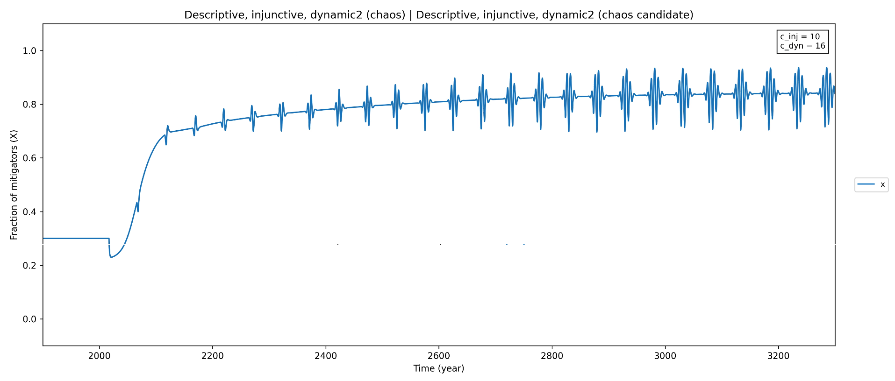

# Aktuelle ToDos:
SENSI:
- social_norm_factor für jede Norm so setzen, dass die Wertebereiche für alle Normen gleich ist? Dadurch ists vergleichbarer.
- PIK Cluster
1. Normen qualitativ beschreiben. Bei Norm 5 weitermachen. Sicherung liegt in downloads
Idee für einheitliche skalierung
- scale_factor scaliert die Wertebereiche von allen Normen auf den selben Bereich
- scale_factor wird pro Norm automatisch berechnet
- social_norm_factor und temperature_factor bleiben frei variierbar, um Norm- und Temperatureinfluss unterschiedlich zu gewichten.
- Der Normbeitrag lautet dann: social_norm_factor * scale_factor * Normterm. Für die dynamischen Normen mit x_ref muss noch ein sinnvoller Skalierungsmaßstab festgelegt werden.
1. zielvariablen anpassen
    - `oscillations_per_500_years`: vermischt Auftreten, Dauer und Frequenz; seltene/extreme Fälle machen Sobol-Indizes instabil; schnelle Schwingungen numerisch prüfen.
    - `oscillation_amplitude`: auch bei nur einem Halbzyklus positiv; abhängig von Erkennungsschwelle; viele Nullwerte erschweren Sobol-Auswertung.
    - `damping_index`: 0 bedeutet sowohl nicht bestimmbar als auch keine Dämpfung; nicht bestimmbare Werte als `NaN` kennzeichnen.
    - `final_x`, `oscillation_amplitude` und `damping_index` sind aus der Sobol-Auswahl und dem Gesamtranking auskommentiert; Rohkennzahlen bleiben gespeichert.
    - Entscheiden, ob `oscillations_per_500_years` ebenfalls weggelassen oder ersetzt werden soll.
    - Eindeutige Frequenz-/Amplitudendefinitionen festlegen: vollständige Zyklen, festes Auswertungsfenster und Umgang mit fehlenden Schwingungen.
    - WICHTIG: CHati soll zunächst für kleinere Löufe testen, ob die neuen Zielvariablen dann wirklich belastbar sind, bevor ich wieder 50+ Stunden Simulationen laufen lasse
1. Sensitivitätsanalyse auch nochmal mit anderen x0-Werten durchführen, um zu prüfen ob sich etwas ändert.
    1. chati fragen welche Möglichkeiten ich habe das zu vergleichen ohne wieder 50 stunden laufen lassen zu müssen
(file:///c%3A/Users/lukas/OneDrive/Uni/Master/Masterarbeit/Socio-Climate-model/plots/todo_loesungen_2026-09-30/index.html)

1. Mit konstantem temperatur-term auch nochmal sensi laufen lassen

1. Bury Paper nochmal gründlich lesen (ab Results)
1. Sensi mit konstantem temperatur-term laufen lassen
    1. dann sollten die Aussagen über Oszillationen aussagekräftiger sein verglichen zwischen den Normtypen.

# Feedback von Hilker und Hannah
1. Solver nochmal kontrollieren
3. Vermutlich sinnvoller über kleineren Zeitraum
    a. Theoretischer dynamiken vs realistische Prognosen
    b. Ursprüngliche Frage war: Treten oszillationen überhaupt auf?
        i. Über längere zeit treten oszillationen immer auf aufgrund des basic modells
    c. Ggf. langfristige Simulationen mit kleinerer samplpesize laufen lassen
    d. Für kurzfristige Simulationen machen einige Zielvariablen wenig sinn
    e. Parameterbereiche mit Hannah festlegen für Sensi
    f. Parameter vorclustern: Evtl verändert sich die dynamik garnicht mehr für bestimmte Parameterwerte

# Sonstige ToDos:
1. dynamic social norm mit dynamic social norm2 vergleichen (und entsprechend auch Descriptive, injunctive, dynamic mit Descriptive, injunctive, dynamic2)
1. Equations und model simulations in 2 Files aufteilen?
1. Batch_runner logisch in mehrere Files aufteilen
1. Plots entwickeln, bei denen man die Parameter direkt in dem Plot bearbeiten kann mit Slidern o..
1. latin hyper cube sampling vergleichen mit meiner aktuellen Sensitivitätsanalyse (sobol indices)
1. Bifurcation-style plots: systematically sweep a key parameter (e.g., norm strength social_norm_factor) and track whether the system undergoes a sharp transition. Different norm types may have different critical thresholds for tipping from a high-emission to a low-emission equilibrium.
1. Konvergenzen Mathematisch berechnen
    1. vorallem relevant für nicht-dynamische und nicht-abm plots. Damit kann ich zb ausschließen, dass es Zwischenzustände bei bestimmten Normen gibt, sondern dass diese immer zu 0/1 konvergieren.
1. Bobachtung bei descriptive injunctve dynamic 2:
    1. Der initiale Fall wird nach ca tau Jahren (hier ca. 40) wieder abgebildet
    1. TODO: auch für kleiner tau testen.
    1. 

1. Zeitschritt vom solver gleichsetzen mit Theta und schauen ob oszillationen noch auftreten (insbesondere auf Folie 34)
    1. das hat bei mir nicht funktioniert 
    1. ggf. im mattermost chat fragen
    
1. Mit Parametern die aktuelle Entwicklung reverse engineeren (also von 1800 zb laufen lasssen)
    1. Und dann schauen, welche Normen die aktuelle Entwicklung besonders gut darstellen
    1. Oder das nutzen, um Parameter zu kalibrieren und dann diese Parameterkombinationen miteinander vergleichen (auch für t>2026)
1. Logistic choice / logistische regression statt replicator equation ausprobieren (könnte interessant sein, aber könnte auch zu viel sein)

# Offene Fragen:
1. Um Struktur in die Auswertung zu bekommen: Konkrete Fragestellungen formulieren
1. Warum fällt die dynamic norm während zb baseline steigt
Bspw. bei x0=0.9
1. Observation-based / intention motivation (agents): Review-Regel umgesetzt; Temperaturerweiterung und Parameterannahmen mit Quellen dokumentiert.
1. Welchen Wert muss x haben, damit die Temperatur fällt?
1. Warum ist social_norm_term = N belief based? Beliefbased heißt doch, dass da auch eine Wertung drin steckt. Wo ist die? N ist laut Beckage konstant
1. Gibt es bestimmte Verhaltensmuster, die nur bei bestimmten Normen auftreten?

# Parameterkombinationen

### Observation-based / imitation

`social_norm_factor` ✅

### Dynamic social norm

`tau_ref`, `social_norm_factor` ✅  
`tau_ref`, `tau_xp` ✅  
`social_norm_factor`, `tau_xp` ✅

### Observation-based / intention motivation (agents)

`network_size`, `eta`, `phi`, `psi`, `beta`, `temperature_factor`

### Belief-based / intention motivation

`N` ✅

### Observation-based / approval (punish only one behaviour)

`social_norm_factor` ✅

### Static injunctive

`social_norm_factor`, `x_target` ✅

### Descriptive, injunctive, dynamic

`social_norm_factor`, `c_inj`  
`social_norm_factor`, `x_target`  
`social_norm_factor`, `c_dyn`  
`social_norm_factor`, `tau_ref`  
`social_norm_factor`, `tau_xp`  
`c_inj`, `x_target`  
`c_inj`, `c_dyn` ✅  
`c_inj`, `tau_ref`  
`c_inj`, `tau_xp`  
`x_target`, `c_dyn`  
`x_target`, `tau_ref`  
`x_target`, `tau_xp`  
`c_dyn`, `tau_ref`  
`c_dyn`, `tau_xp`  
`tau_ref`, `tau_xp`  

### Descriptive, injunctive, dynamic2

`social_norm_factor`, `c_inj`  
`social_norm_factor`, `x_target`  
`social_norm_factor`, `c_dyn`  
`social_norm_factor`, `tau`  
`social_norm_factor`, `theta`  
`c_inj`, `x_target`  
`c_inj`, `c_dyn` ✅  
`c_inj`, `tau`  
`c_inj`, `theta`  
`x_target`, `c_dyn`  
`x_target`, `tau`  
`x_target`, `theta`  
`c_dyn`, `tau`  
`c_dyn`, `theta`  
`tau`, `theta`

### Injunctive, dynamic2

`c_inj`, `x_target`  
`c_inj`, `c_dyn`  
`c_inj`, `tau`  
`c_inj`, `theta`  
`x_target`, `c_dyn`  
`x_target`, `tau`  
`x_target`, `theta`  
`c_dyn`, `tau`  
`c_dyn`, `theta`  
`tau`, `theta` ✅

### Dynamic social norm2

`c_dyn`, `tau`  
`c_dyn`, `theta`  
`tau`, `theta` ✅
